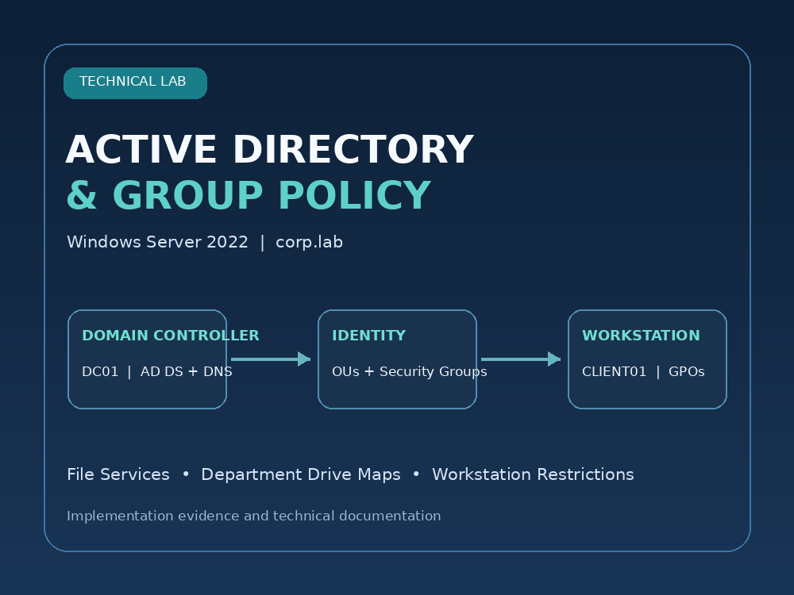
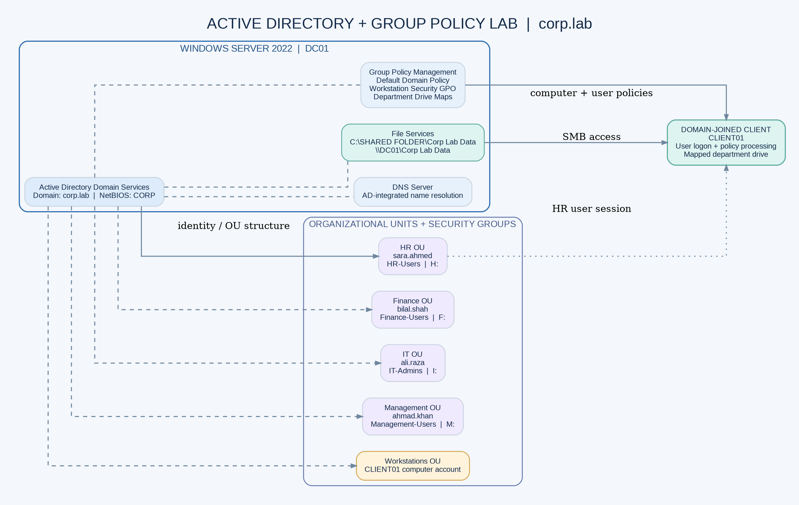

# Active Directory & Group Policy Lab

**Windows Server 2022 | Active Directory Domain Services | DNS | Group Policy | File Services**

A hands-on Windows domain services lab demonstrating a small departmental environment with centralized identity, security groups, shared folders, mapped network drives, domain account policies, and workstation restrictions.



## Project overview

The lab uses the `corp.lab` Active Directory domain (NetBIOS: `CORP`) with a Windows Server 2022 domain controller identified in the working notes as `DC01` and a domain-joined client named `CLIENT01`.

The implementation includes:

- Active Directory Domain Services and DNS for the `corp.lab` domain.
- Departmental OUs for Management, IT, HR, Finance, and Workstations.
- Department security groups and representative user accounts.
- An SMB share at `\\DC01\Corp Lab Data`, backed by `C:\SHARED FOLDER\Corp Lab Data`.
- Department folders and user drive mappings.
- Domain password and account-lockout policies.
- Central workstation restrictions managed through Group Policy.
- HR-user validation evidence captured on `CLIENT01`.



## Environment

| Component | Value |
|---|---|
| Server platform | Windows Server 2022 |
| Domain | `corp.lab` |
| NetBIOS name | `CORP` |
| Domain controller / file server label | `DC01` |
| Client | `CLIENT01` (domain joined) |
| Shared folder local path | `C:\SHARED FOLDER\Corp Lab Data` |
| Shared folder UNC | `\\DC01\Corp Lab Data` |

IP addressing is intentionally not hard-coded here because the virtual network was adjusted during the lab and screenshots show more than one network state. Confirm the active server and client addresses in the live VM before reproducing the setup.

## Active Directory structure

| OU | Representative user / computer | Security group |
|---|---|---|
| Management | `ahmad.khan` | `Management-Users` |
| IT | `ali.raza` | `IT-Admins` |
| HR | `sara.ahmed` | `HR-Users` |
| Finance | `bilal.shah` | `Finance-Users` |
| Workstations | `CLIENT01` computer account | N/A |

The domain also contains the standard AD containers and the Domain Controllers OU. The user objects should be located in their matching department OUs for the OU-linked user policies to process as designed.

## File services and drive maps

| Department | Folder | UNC path | Drive |
|---|---|---|---|
| HR | `HR DATA` | `\\DC01\Corp Lab Data\HR DATA` | H: |
| Finance | `Finance` | `\\DC01\Corp Lab Data\Finance` | F: |
| IT | `IT` | `\\DC01\Corp Lab Data\IT` | I: |
| Management | `Management` | `\\DC01\Corp Lab Data\Management` | M: |

Drive Maps are configured through User Configuration > Preferences > Windows Settings > Drive Maps, using the Update action and reconnect enabled. Folder-level NTFS permissions are intended to grant each department access to its own folder. Share-level and NTFS-level permissions must both be reviewed because the effective access is constrained by both layers.

## Group Policy inventory

| Policy object | Intended scope | Purpose |
|---|---|---|
| Default Domain Policy | Domain | Password and account-lockout policy |
| `GPO-HR-Drive-Mapping` | HR OU | Map H: to the HR folder |
| `GPO-Finance-Drive-Mapping` | Finance OU | Map F: to the Finance folder |
| `GPO-IT-Drive-Mapping` | IT OU | Map I: to the IT folder |
| `GPO-Management-Drive-Mapping` | Management OU | Map M: to the Management folder |
| `GPO-HR-Desktop-Restrictions` | HR OU | Restrict Control Panel and PC settings for HR users |
| `GPO-Domain-Workstation-Security` | Linked at domain root in the lab | Central workstation and user restrictions |

### Captured domain account policy values

The supplied screenshots show the following values in the Default Domain Policy:

| Password / lockout setting | Captured value |
|---|---:|
| Enforce password history | 24 passwords remembered |
| Maximum password age | 50 days |
| Minimum password age | 1 day |
| Minimum password length | 5 characters |
| Password complexity | Enabled |
| Store passwords using reversible encryption | Disabled |
| Account lockout threshold | 10 invalid logon attempts |
| Account lockout duration | 5 minutes |
| Reset account lockout counter after | 5 minutes |
| Allow Administrator account lockout | Enabled |

These are recorded as observed, not recommended baseline values. See [Security Review](docs/Security-Review-and-Remediation.md) for the items to correct before calling the lab hardened.

## Workstation restrictions

The lab work and supplied evidence include the following settings:

- Deny access to all removable storage classes.
- Deny CD/DVD read and write access.
- Turn off AutoPlay for all drives.
- Prevent access to Command Prompt.
- Prevent access to Registry Editor (configured in the working session; client test evidence not included).
- Prohibit access to Control Panel and PC settings.
- Hide selected Settings pages using Settings Page Visibility.
- Prevent changing proxy settings through the legacy Internet Explorer administrative template.
- Restrict launch of specified PowerShell executables and remove the Run command from the Start menu (configured in the working session; client test evidence not included).

**Important security finding:** one supplied screenshot shows **Always install with elevated privileges** set to Enabled. This is not a user-installation restriction. It can grant Windows Installer elevated privileges and must be set to Disabled in both Computer Configuration and User Configuration before the policy is considered safe. See the security review.

## Validation status

The supplied evidence includes:

- `corp.lab` visible in Active Directory Users and Computers, with the department OUs and security groups.
- The `Corp Lab Data` network share created.
- Password and account-lockout policy values visible in Group Policy Management Editor.
- Department drive-mapping policy configuration screens.
- A successful `sara.ahmed` logon on the client.
- The HR network drive H: visible in File Explorer.
- A Windows restriction message when a restricted operation is attempted.
- CD/DVD drive access denied on the client.

The supplied evidence does **not** show successful client-side tests for USB storage, Command Prompt, Registry Editor, PowerShell, the Run command, or every departmental mapped drive. Those items are documented as configured or awaiting separate verification, not as passed tests.

## Repository layout

```text
active-directory-group-policy-lab/
├── README.md
├── assets/
│   ├── architecture.dot
│   ├── architecture.png
│   ├── architecture.svg
│   └── portfolio-cover.png
├── docs/
│   ├── Implementation-Runbook.md
│   ├── Security-Review-and-Remediation.md
│   ├── Validation-Results.md
│   ├── Project-Overview.docx
│   ├── Project-Overview.pdf
│   ├── Technical-Implementation-Report.docx
│   ├── Technical-Implementation-Report.pdf
│   ├── Implementation-Runbook.md
│   ├── Validation-Results.md
│   └── Security-Review-and-Remediation.md
├── publishing/
│   ├── Upwork-Portfolio-Copy.md
│   ├── LinkedIn-Post.md
│   ├── LinkedIn-Featured-Copy.md
│   └── Publishing-Guide.md
└── screenshots/
    └── 01 ... 12 evidence images
```

## Reproduction notes

1. Build the Windows Server 2022 domain controller and configure DNS.
2. Create the `corp.lab` forest and verify DNS/name resolution from the client.
3. Create the departmental OUs, user accounts, and security groups.
4. Join `CLIENT01` to the domain and place its computer account in the Workstations OU.
5. Create `C:\SHARED FOLDER\Corp Lab Data`, share it as `Corp Lab Data`, and create the four department folders.
6. Apply least-privilege share and NTFS permissions to the root and department folders.
7. Configure domain account policy and department drive-mapping GPOs.
8. Configure workstation restrictions with appropriate scope and security filtering.
9. Validate each setting from a standard domain user session and document the results.

## Security and privacy notes

- This is a controlled lab demonstration, not evidence of a production deployment.
- Do not publish passwords, recovery keys, DSRM credentials, private network details, or real company data.
- Use non-sensitive test accounts only. Do not expose administrator credentials in screenshots.
- Review the security findings before reusing the GPOs outside this isolated lab.

## Reference

Microsoft Learn recommends avoiding the `AlwaysInstallElevated` policy because it can allow a non-administrator to run an installation with elevated privileges. See [Windows Installer Best Practices](https://learn.microsoft.com/en-us/windows/desktop/Msi/windows-installer-best-practices) and [Machine Policies](https://learn.microsoft.com/en-us/windows/win32/msi/machine-policies).
